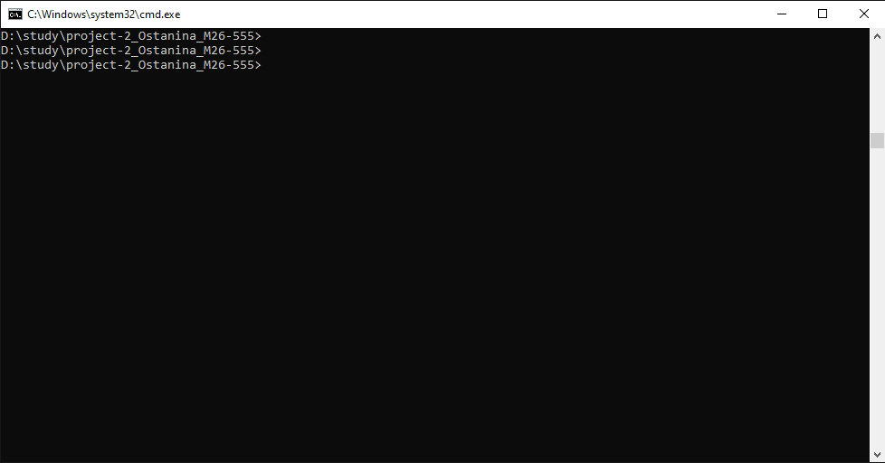

## Primitive DB
Консольное приложение, имитирующее работу с реляционной базой данных. Проект реализован на Python с использованием процедурного подхода. Поддерживает управление таблицами, CRUD-операции, валидацию типов, кэширование запросов и подтверждение опасных действий.
#### Используемые технологии
- Python 3.12
- uv (управление проектом, зависимостями и виртуальным окружением)
- Ruff (статический анализ и форматирование кода по PEP8)
- PrettyTable (форматированный вывод данных в консоль)
- prompt (взаимодействие с пользователем)
#### Установка и запуск
- Для работы необходим менеджер проектов uv
- Склонируйте репозиторий и перейдите в папку с проектом.
- Синхронизируйте зависимости и создайте виртуальное окружение:
```uv sync```
Запустите приложение:
```uv run database```
#### Доступные команды
Управление таблицами
```create_table <имя> <столбец1:тип> ...``` — создать таблицу (столбец ID:int добавляется автоматически).
```list_tables``` — показать список всех существующих таблиц.
```drop_table <имя>``` — удалить таблицу (требует подтверждения).
Операции с данными (CRUD)
```insert into <таблица> values (<значение1>, <значение2>, ...)``` — добавить новую запись.
```select from <таблица> [where <столбец> = <значение>]``` — прочитать записи (с поддержкой кэширования).
```update <таблица> set <столбец> = <значение> where <столбец> = <значение>``` — обновить записи.
```delete from <таблица> where <столбец> = <значение>``` — удалить записи (требует подтверждения).
```info <таблица>``` — вывести структуру таблицы и количество записей.
Общие команды
```help``` — показать справочную информацию.
```exit``` — корректный выход из программы.
#### Демонстрация работы
Запись сеанса работы с базой данных (создание таблицы, добавление данных, выборка с кэшированием, обновление и удаление).
